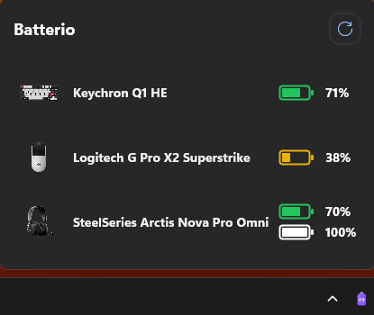
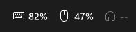
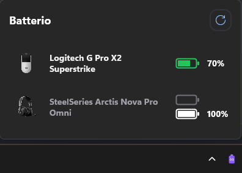
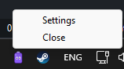
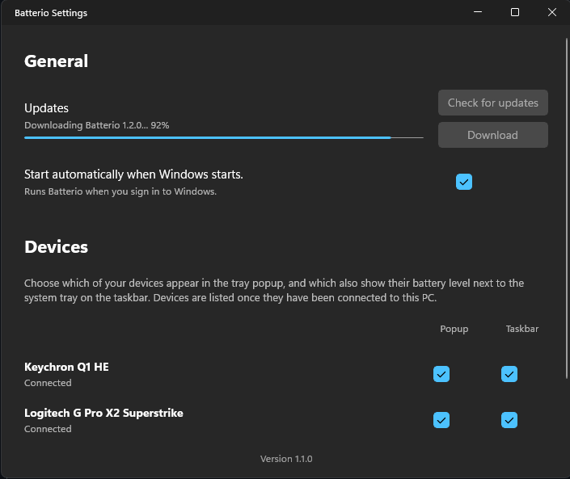

# Batterio

A Windows 11 x64 system tray app that shows the battery level of wireless gaming peripherals.

Supported devices:

- **Keychron Q1 HE**: battery through the **Keychron Link** 2.4 GHz receiver. This requires **custom firmware** that makes the keyboard report its battery; with the stock firmware, or while the keyboard is asleep or off, it shows as offline. The firmware is available in [luka223/qmk_firmware](https://github.com/luka223/qmk_firmware). **Flash it at your own risk**: flashing custom firmware can brick your keyboard and may void its warranty.
- **Logitech G Pro X2 Superstrike**: over USB-C cable or Lightspeed receiver
- **Logitech G Pro X2 Lightspeed**: through its receiver
- **SteelSeries Arctis Nova Pro Omni**: headset and reserve battery through the GameHub (hub must be in **USB-1** mode)
- **Logitech MX Master 3S** and **Logitech MX Keys Mechanical**: over **Bluetooth** (verified on hardware) or through their **Logi Bolt** receiver (*experimental, unverified on hardware*). Each device is handled on its own, so the mouse can be on Bolt and the keyboard on Bluetooth, and a device you do not own is not listed. A sleeping device, or one switched to another Easy-Switch channel, shows as offline, and is read again within moments of waking up or being switched back.

Left-click the tray icon to open the popup, right-click it for the menu (Settings, Close). Batterio sends a Windows notification once per run when a device drops below 30% and when it is fully charged.

### Taskbar strip

Devices can also show their battery level on the taskbar, next to the system tray: a mouse, keyboard or headphones glyph, the percentage, and an amber lightning bolt while charging. It is off by default. In **Settings**, tick the **Taskbar** box of a device (it needs the **Popup** box ticked as well). The number turns yellow from 20% to 40% and red below 20%, as in the popup (it stays in the normal colour while charging, like the popup's green battery). A device that is offline or disconnected stays on the strip, dimmed, with `--` instead of a percentage. For the SteelSeries Arctis Nova Pro Omni only the main battery is shown. Clicking the strip works like clicking the tray icon: left-click toggles the popup, right-click opens the menu.

The strip is shown on the primary taskbar only, and only while the taskbar is at the bottom of the screen. On a crowded, left-aligned taskbar it can overlap pinned apps.

## Screenshots

- **Popup**

  

- **Taskbar strip**

  

- **Disabled (turned off) device**

  

- **Tray menu**

  

- **Settings**

  

## Technologies

- .NET 10 (SDK pinned in `global.json`) and .NET MAUI on WinUI / Windows App SDK
- Raw HID communication (Logitech HID++, SteelSeries vendor protocol)
- NativeAOT launcher that starts and supervises the WinUI runtime process

## Project layout

| Path | Purpose |
| --- | --- |
| `src/Batterio.Core` | Device adapters, polling, notifications logic, settings |
| `src/Batterio.App` | MAUI/WinUI tray app, popup and native taskbar strip (`Batterio.Runtime.exe`) |
| `src/Batterio.Startup` | NativeAOT launcher (`Batterio.App.exe` / `Batterio.exe`) |
| `tests/` | Unit tests plus manual startup and notification probes |
| `eng/` | Publish scripts |

New devices are added by implementing `IBatteryAdapterFactory` / `IBatteryAdapter` and registering them in `MauiProgram` and `BuiltInDevices.Create()`.

## Prerequisites

**Running**: nothing to install. Both publish outputs are self-contained: the .NET runtime and the Windows App Runtime are bundled, the launcher is compiled with NativeAOT, and devices are read through the HID APIs built into Windows. Logitech G HUB, Logi Options+ and SteelSeries GG are not needed; Batterio opens devices in shared mode, so it also runs alongside them.

**Building** requires:

- **.NET 10 SDK**, the version pinned in `global.json`, to build and publish the solution.
- **.NET MAUI Windows workload** (`dotnet workload install maui-windows`), because the tray app and popup are a MAUI/WinUI project.
- **Visual Studio C++ x64 build tools** (the "Desktop development with C++" workload, or the Build Tools equivalent with the Windows SDK), because NativeAOT compiles the launcher to native code and needs the MSVC linker and Windows SDK libraries.
- **Windows App Runtime 2.x**, only for Debug runs (`dotnet run`, or F5 in Visual Studio). Only Release builds bundle the Windows App SDK, so a Debug build loads the runtime installed on the machine and fails to start without it. Published builds do not need it.

## Build and run

```powershell
dotnet restore Batterio.sln --configfile NuGet.Config --runtime win-x64
dotnet build Batterio.sln -c Release --no-restore
dotnet test Batterio.sln -c Release --no-build
dotnet run --project src/Batterio.App/Batterio.App.csproj -c Debug
```

Hardware tests are opt-in: set `BATTERIO_HARDWARE_TESTS=1` with the devices connected.

## Publish

Both scripts produce a self-contained `win-x64` build; no .NET or Windows App Runtime install is needed on the target machine.

**Folder build**: outputs the `publish` folder. Copy the whole folder and run `Batterio.App.exe` from it.

```powershell
.\eng\Publish-Batterio.ps1
& .\publish\Batterio.App.exe
```

**Single-file build**: outputs a single `publish-self-contained\Batterio.exe`. On first start it unpacks itself to `%LocalAppData%\Batterio\Runtime`.

```powershell
.\eng\Publish-Batterio-self-contained.ps1
& .\publish-self-contained\Batterio.exe
```

## Updating

New versions are published as a single `Batterio.exe` on the GitHub releases page. The installed version is shown at the bottom of the Settings page.

Batterio checks for a newer release shortly after it starts and shows a notification when one is available; clicking it opens Settings. The **Updates** section of Settings can also check on demand:

1. **Check for updates** asks GitHub for the latest release. If there is none newer, it shows **✓ Batterio is up to date**.
2. **Download** fetches the new `Batterio.exe` next to the current one (as `Batterio.exe.download`) with a progress bar, and verifies it against the release's SHA-256 checksum.
3. **Update now** replaces `Batterio.exe` in its folder and restarts Batterio into the new version. The previous file is kept as `Batterio.exe.old` until the new version has started, and is restored if the new one cannot be launched.

The folder that holds `Batterio.exe` must be writable by you; otherwise Settings explains why the update failed and you can update by hand: close Batterio (right-click the tray icon and choose **Close**), replace `Batterio.exe` with the one from the releases page, and run it. The folder build cannot update itself and only links to the releases page.

Settings and device selections are kept, since they live in `%LocalAppData%\Batterio`, not next to the exe. If **Start automatically when Windows starts** was on, it is pointed at the new exe on its first start, even if it is in a different folder or has a different name. The unpacked copy of the previous version in `%LocalAppData%\Batterio\Runtime` is removed automatically.

For the folder build, close Batterio and replace the whole folder with the new one; do not mix files from different versions.

To release a new version, bump `<Version>` in `Directory.Build.props`, run the single-file publish script, and attach the resulting `Batterio.exe` to a GitHub release whose tag is the version (for example `1.2.0`). Running copies only see published releases; drafts and prereleases are ignored.

## Data and diagnostics

- Settings: `%LocalAppData%\Batterio\settings.json`
- Logs: `%LocalAppData%\Batterio\Logs\` (`batterio.log`, `startup.log`)
- Set `BATTERIO_TRACE_HID=1` to log raw HID packets.
- To fully remove the app, also delete `%AppData%\Microsoft\Windows\Start Menu\Programs\Batterio.lnk` and `HKCU\Software\Classes\CLSID\{B68D18D7-6B67-4C24-993C-B597D789E895}`.
