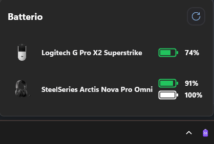
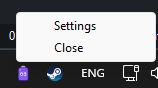
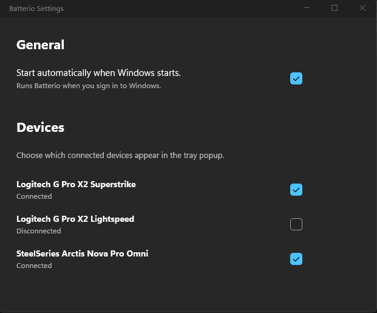

# Batterio

A Windows 11 x64 system tray app that shows the battery level of wireless gaming peripherals.

Supported devices:

- **Logitech G Pro X2 Superstrike**: over USB-C cable or Lightspeed receiver
- **Logitech G Pro X2 Lightspeed**: through its receiver
- **SteelSeries Arctis Nova Pro Omni**: headset and reserve battery through the GameHub (hub must be in **USB-1** mode)
- **Logitech MX Master 3S** and **Logitech MX Keys Mechanical** (*experimental, unverified on hardware*): through their **Logi Bolt** receiver. A sleeping device shows as offline until it wakes.

Left-click the tray icon to open the popup, right-click it for the menu (Settings, Close). Batterio sends a Windows notification once per run when a device drops below 30% and when it is fully charged.

## Screenshots

| Popup | Tray menu | Settings |
| --- | --- | --- |
|  |  |  |

## Technologies

- .NET 10 (SDK pinned in `global.json`) and .NET MAUI on WinUI / Windows App SDK
- Raw HID communication (Logitech HID++, SteelSeries vendor protocol)
- NativeAOT launcher that starts and supervises the WinUI runtime process

## Project layout

| Path | Purpose |
| --- | --- |
| `src/Batterio.Core` | Device adapters, polling, notifications logic, settings |
| `src/Batterio.App` | MAUI/WinUI tray app and popup (`Batterio.Runtime.exe`) |
| `src/Batterio.Startup` | NativeAOT launcher (`Batterio.App.exe` / `Batterio.exe`) |
| `tests/` | Unit tests plus manual startup and notification probes |
| `eng/` | Publish scripts |

New devices are added by implementing `IBatteryAdapterFactory` / `IBatteryAdapter` and registering them in `MauiProgram` and `BuiltInDevices.Create()`.

## Prerequisites

**Running**: nothing to install. Both publish outputs are self-contained: the .NET runtime and the Windows App Runtime are bundled, the launcher is compiled with NativeAOT, and devices are read through the HID APIs built into Windows. Logitech G HUB, Logi Options+ and SteelSeries GG are not needed; Batterio opens devices in shared mode, so it also runs alongside them.

**Building** requires:

- **.NET 10 SDK**, the version pinned in `global.json`, to build and publish the solution.
- **.NET MAUI Windows workload** (`dotnet workload install maui-windows`), because the tray app and popup are a MAUI/WinUI project.
- **Visual Studio C++ x64 build tools** (the "Desktop development with C++" workload, or the Build Tools equivalent with the Windows SDK), because NativeAOT compiles the launcher to native code and needs the MSVC linker and Windows SDK libraries.
- **Windows App Runtime 2.x**, only for Debug runs (`dotnet run`, or F5 in Visual Studio). Only Release builds bundle the Windows App SDK, so a Debug build loads the runtime installed on the machine and fails to start without it. Published builds do not need it.

## Build and run

```powershell
dotnet restore Batterio.sln --configfile NuGet.Config --runtime win-x64
dotnet build Batterio.sln -c Release --no-restore
dotnet test Batterio.sln -c Release --no-build
dotnet run --project src/Batterio.App/Batterio.App.csproj -c Debug
```

Hardware tests are opt-in: set `BATTERIO_HARDWARE_TESTS=1` with the devices connected.

## Publish

Both scripts produce a self-contained `win-x64` build; no .NET or Windows App Runtime install is needed on the target machine.

**Folder build**: outputs the `publish` folder. Copy the whole folder and run `Batterio.App.exe` from it.

```powershell
.\eng\Publish-Batterio.ps1
& .\publish\Batterio.App.exe
```

**Single-file build**: outputs a single `publish-self-contained\Batterio.exe`. On first start it unpacks itself to `%LocalAppData%\Batterio\Runtime`.

```powershell
.\eng\Publish-Batterio-self-contained.ps1
& .\publish-self-contained\Batterio.exe
```

## Updating

New versions are published as a single `Batterio.exe` on the GitHub releases page. The installed version is shown at the bottom of the Settings page.

1. Close Batterio: right-click the tray icon and choose **Close**.
2. Delete the old `Batterio.exe`.
3. Download the new `Batterio.exe` and run it.

Settings and device selections are kept, since they live in `%LocalAppData%\Batterio`, not next to the exe. If **Start automatically when Windows starts** was on, it is pointed at the new exe on its first start, even if it is in a different folder or has a different name. The unpacked copy of the previous version in `%LocalAppData%\Batterio\Runtime` is removed automatically.

For the folder build, close Batterio and replace the whole folder with the new one; do not mix files from different versions.

To release a new version, bump `<Version>` in `Directory.Build.props` and run the single-file publish script.

## Data and diagnostics

- Settings: `%LocalAppData%\Batterio\settings.json`
- Logs: `%LocalAppData%\Batterio\Logs\` (`batterio.log`, `startup.log`)
- Set `BATTERIO_TRACE_HID=1` to log raw HID packets.
- To fully remove the app, also delete `%AppData%\Microsoft\Windows\Start Menu\Programs\Batterio.lnk` and `HKCU\Software\Classes\CLSID\{B68D18D7-6B67-4C24-993C-B597D789E895}`.
